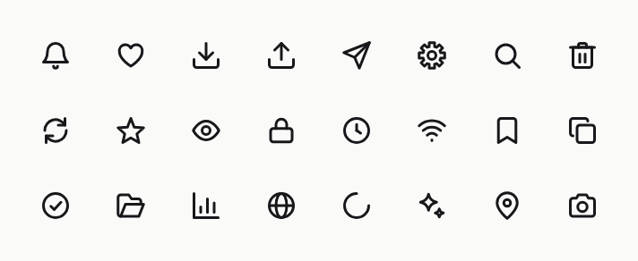

# nudge-icons

Animated line icons for React and Vue. Each icon has its own small motion that hints at what it does: the bell rings, the arrow sinks into the tray, the menu folds into a cross. The motion is CSS only, so there is no animation runtime, and it stops under `prefers-reduced-motion`.

[](https://www.npmjs.com/package/@nudge-icons/react)
[](https://github.com/dimon85/nudge-icons/actions/workflows/ci.yml)
[](LICENSE)



**[Browse the icons](https://dimon85.github.io/nudge-icons/)** · [Docs](https://dimon85.github.io/nudge-icons/docs/getting-started) · [Migrate from Lucide](https://dimon85.github.io/nudge-icons/docs/migrate-from-lucide)

## Why

- **Motion with meaning.** Every icon moves in its own way, on hover by default, also when the button or link around it is hovered or focused.
- **CSS only.** No JS animation library. Icons move before hydration, work with server rendering, and stop under reduced motion with nothing to set up.
- **Small.** One animated icon adds about 1.1 kB to your bundle, every next one about 0.2 kB.
- **Drop-in for Lucide.** The same 24-unit grid, 2-unit stroke and props (`size`, `color`, `strokeWidth`, `absoluteStrokeWidth`), so both sets can live side by side while you switch.
- **Second states.** `<Menu active={open} />` folds the lines into a cross, with a transition, instead of swapping two icons.
- **Styleable parts.** The moving pieces have names (`data-part="clapper"`), so you can colour one part with CSS.
- **React and Vue from one source,** plus plain SVG files and a shadcn registry.

## Install

```sh
pnpm add @nudge-icons/react   # React 19+
pnpm add @nudge-icons/vue     # Vue 3.3+
```

## Use

```tsx
import { Bell, Menu } from "@nudge-icons/react";

<button>
  <Bell size={16} /> Notifications
</button>;

<button aria-expanded={open} aria-label="Menu" onClick={() => setOpen(!open)}>
  <Menu active={open} />
</button>;
```

```vue
<script setup lang="ts">
import { Bell } from "@nudge-icons/vue";
</script>

<template>
  <button><Bell :size="16" /> Notifications</button>
</template>
```

`animate` sets when the motion plays: `"hover"` (default), `"loop"`, `"once"`, a number of runs, or `false`. For still icons everywhere, import from `@nudge-icons/react/static` or `@nudge-icons/vue/static`.

Icons are hidden from screen readers unless they get a `title` (or `aria-label`); then they have `role="img"`. See [Accessibility](https://dimon85.github.io/nudge-icons/docs/accessibility) and [Styling](https://dimon85.github.io/nudge-icons/docs/styling).

## Other ways to get the icons

- **Copy the source** with the shadcn CLI, no package to keep up to date: `npx shadcn@latest add https://dimon85.github.io/nudge-icons/r/bell.json` (Vue: `npx shadcn-vue@latest add https://dimon85.github.io/nudge-icons/r/vue/bell.json`).
- **Plain SVG** files and `icons.json` with every icon's metadata: [`@nudge-icons/svg`](packages/svg).
- **AI coding agents:** [llms.txt](https://dimon85.github.io/nudge-icons/llms.txt), [llms-full.txt](https://dimon85.github.io/nudge-icons/llms-full.txt) and a [skill](skills/nudge-icons) for Claude Code.

## Size

Bytes after minifying and brotli, bundled with esbuild, React left out, measured on 8 November 2026. "One icon" imports `Heart`; "+1" is the cost of also importing `Bell`.

| Library                      | One icon | +1   |
| ---------------------------- | -------- | ---- |
| nudge-icons, animated        | 1135     | +209 |
| nudge-icons, `/static`       | 572      | +56  |
| lucide-react 1.70.0          | 1751     | +126 |
| @heroicons/react 2.2.0       | 363      | +131 |
| @tabler/icons-react 3.50.0   | 627      | +109 |
| @phosphor-icons/react 2.1.10 | 1262     | +619 |

The extra bytes of an animated icon are its motion CSS. Animated icon sets built on a JS animation library also load that library, tens of kilobytes before the first icon. CI keeps these numbers within the limits in [`.size-limit.json`](.size-limit.json).

## Development

```sh
pnpm install
pnpm site            # the docs site with the gallery
pnpm preview         # every icon on one page, for drawing work
pnpm storybook       # the visual test bench
pnpm check:icons && pnpm lint && pnpm typecheck && pnpm test && pnpm build
```

The icons live in [`icons/`](icons) as SVG and JSON; the React and Vue components, the SVG package, the registry and the site's data are generated from them. Drawing rules and how to add an icon are in [CONTRIBUTING.md](CONTRIBUTING.md).

## License

[MIT](LICENSE) © Dmytro Shyshko
